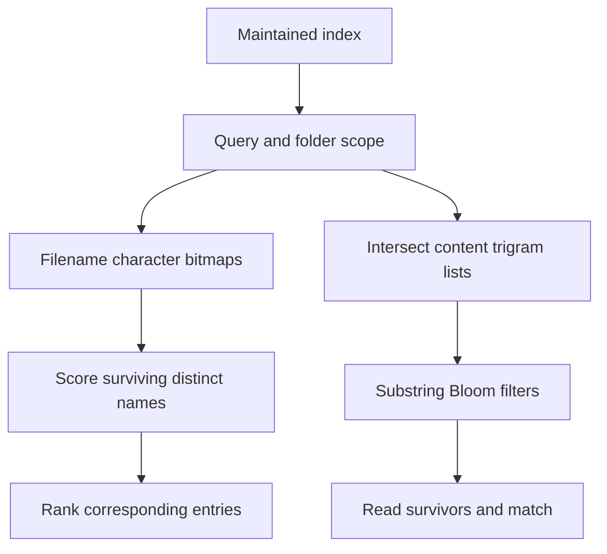

# FSearch: discover structure, then remove work

## Goal and workload

Search millions of filenames and file contents interactively, with typo tolerance and folder scope.
Repeated queries justify an initial index and incremental maintenance.

## Mechanisms: stored data → operation → saving

1. **Prepare state once.** Enumerate directory metadata in batches to build compact index arrays.
   Map those arrays into memory instead of reconstructing filename objects on each launch.
   Keep the engine alive in a daemon; CLI requests send queries to it instead of rebuilding state.
   Filesystem events identify changed regions; diffs update an overlay until compaction merges it.
2. **Compute once per distinct value.** Give each unique filename an ID; entries reference that ID.
   Score a name once, then apply its score to matching entries with their own paths and metadata.
   Identical file contents also share indexed data. Copies retain separate paths without duplicate
   content indexing.
3. **Turn folder scope into bounds.** Store directory blocks in depth-first order.
   A folder's descendants occupy one entry range `[start, end)`.
   `config in:~/Developer` visits that range instead of testing every entry's path for membership.
4. **Use bits before strings.** For each character class, store a bitmap of names containing it.
   Without typo tolerance, `main` needs the classes for `m`, `a`, `i`, and `n`.
   Intersect those bitmaps to test 64 names per machine word before reading their strings.
   Score surviving names: character classes do not establish order or match quality.
   Typo-aware filtering allows the supported missing-class cases instead of rejecting them.
5. **Use an index before file reads.** Map each three-byte substring to IDs of indexed contents.
   `search` yields `sea`, `ear`, `arc`, `rch`; intersect their lists, starting with the shortest.
   Candidates can contain those pieces far apart. Test a Bloom filter of longer substrings next.
   Hash each substring to bit positions. An unset required bit rejects it.
   Set bits permit false positives, so the filter cannot confirm a match.
   Expand surviving content IDs to file paths, open those files, and confirm the actual match.

## How the reductions compose

Choose sparse entry visits or sequential scans by candidate count.
For supported broad queries, visit promising names first. Stop when no unvisited name can beat
the worst retained result.
Apply SIMD and parallel batches to remaining large work; run small work inline.
Choose the route from query structure and candidate count.

## Invariants and trade-offs

1. **Share equivalent work.** Equal names permit shared scoring; paths and metadata remain distinct.
   Equal indexed contents still require separate paths.
2. **Prove rejection and reuse.** Respect typo rules; reuse candidates only when the query narrows.
   Use a complete candidate set valid for the current index state. Mode changes can widen matches.
3. **Measure selectivity after earlier filters.** Character correlations can mislead estimates.
   Sample candidate bitmaps when uncertain; count only additional savings.
4. **Check completeness and freshness separately.** Current reads verify selected files.
   A lagging index can omit newly matching files. Equal result digests do not prove completeness.
5. **Budget maintenance and recovery.** Overlays add query work until compaction.
   Replay complete change history; relist uncertain regions when history is missing.

Retained indexes and filters trade storage and update work for fewer query-time reads.
Mapping still incurs page faults and storage traffic; daemon startup remains a lifecycle cost.
Compare queries, updates, rebuilds, storage, and cold access against the same result contract.
Test pruning failures, typo boundaries, missed events, and restarts. Measure the assembled path.

Source: [FSearch](https://github.com/noahdunnagan/fsearch), revision
`ffcb37d9297e716fcfdcef3169d752fcf18e3b1b`.
