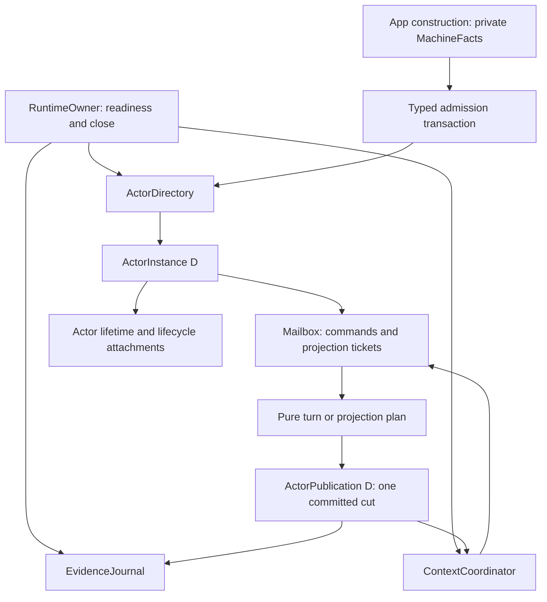

# Runtime cleanup: final design and implementation packet

**Next implementation step: turn the named F1–F8 pending cases into failing executable regressions, then repair their owning boundaries in the order below.** This document finalizes the design; it does not claim that those repairs already exist.

Decisions frozen on 2026-09-10 against production HEAD `6a7a64f976fb7f90abdc2ad2f126455329c79ea1`. Scope: `packages/flow-state-rewrite/src/runtime`, its real tests, and the AppPlan facts boundary specifically named below. The frozen `packages/flow-state` package, normative contracts, generated outputs, public Phase 3/4/5 features, and unrelated `initial_review.md` stay outside implementation scope. No Beads mutations, commits, or pushes are part of this preparation.

## Completed preparation

- Deleted eight runtime `*.stub.ts` files and eight `test/*.stub.test.ts` files outright.
- Deleted `stub-surface.compile.ts` and `test/runtime-parity.test.ts` outright. No migration, replacement compile surface, preserved stub inventory, or title-parity requirement is part of this plan.
- Added **49** specific `it.todo` cases with adjacent setup/action/assertion comments in six real suites. They are a pending regression backlog, not executed proof. Existing executable tests remain executable.
- Labelled five existing short tests as walkthroughs with setup/action/assertion explanations; corrected six misleading test titles. Their executable assertions and behavior remain unchanged.
- Fixed the owner boundaries, publication protocol, context coordination, cleanup policies, file destinations, and prohibited patterns below. Implementation and verification remain future work; architectural choices do not.

The deletion removes **18 files / 3,468 lines**. Future net reduction will be measured from the implementation diff; there is no percentage quota. The preceding executable baseline is 12 runtime suites / 317 passing cases. Eight confirmed defect families below remain unfixed in live production source.

## Authority and confirmed failures

Use the named clauses in [SEMANTICS.md](reference/incident-console/implementation/contracts/SEMANTICS.md), [ARCHITECTURE.md](reference/incident-console/implementation/contracts/ARCHITECTURE.md), [SNAPSHOTS.md](reference/incident-console/implementation/contracts/SNAPSHOTS.md), [PERSISTENCE_AND_ARTIFACTS.md](reference/incident-console/implementation/contracts/PERSISTENCE_AND_ARTIFACTS.md), [GLOSSARY_AND_IDENTITY.md](reference/incident-console/implementation/contracts/GLOSSARY_AND_IDENTITY.md), and [PROOF_MATRIX.md](reference/incident-console/implementation/contracts/PROOF_MATRIX.md). This packet selects private implementation policies within those laws; it does not amend them.

| ID | Confirmed defect and source anchor | Required observable correction |
| --- | --- | --- |
| F1 | `runtime.ts` disposal paths around `1147` / `1238` close gates before the provider/dependent guard. | Rejected direct or lease disposal preserves provider admission, publication, graph edges, and active/suspended consumers. SEM-024 / GLO-08. |
| F2 | `runtime.ts:602` `visibleLifecycle` and later `projectVisibleSnapshot` overlay lifecycle without one published engine cut. | Getter, existing/late stream, callback, and evidence share the same immutable lifecycle snapshot and public revision. SEM-024 / SEM-028. |
| F3 | `evidence.ts:1108` `latestMachineTurnRevision` is runtime-global and reused by lifecycle records. | Lifecycle records use that actor's prior machine-turn revision; journal sequence remains runtime-global. WIRE-020B. |
| F4 | `context-wave.ts:826` onward advances a valid sibling ledger even when another selector rejects the aggregate. | Failed aggregate preserves every committed slot; a newer provider revision later publishes the complete pending aggregate. SEM-002A / SEM-026. |
| F5 | `runtime-services.ts:147` uses `Date.now`; `evidence.ts:1110` obtains time through a nested default runner. | Captured provided Effect Clock controls runtime time, evidence timestamps, and absolute timer scheduling. SNAP-010 / SEM-019. |
| F6 | Sink drain at `evidence.ts:575` consumes beyond its caller's captured prefix. | Concurrent newer acceptance remains queued for a later drain; the first drain terminates at its captured prefix. WIRE-020B. |
| F7 | `actor-admission.ts:1727` and `lifecycle.ts:294` reserve a shared completion while constructing a disposal Effect. | Constructing and discarding `lease.dispose()` changes nothing; the first executed attempt owns cleanup and later callers join it. |
| F8 | Admission/lifecycle rollback uses `Cause.combine`, which deduplicates equal rc.112 reasons. | Two distinct cleanup participants with equal failures retain two ordered reasons; typed failure, defect, and interruption lanes survive. ARCH-026/028 / SEM-023. |

F1–F6 were reproduced through seven temporary failing behavioral probes, including both F1 disposal routes. F7 was reproduced through the real lease: constructing an unused disposal Effect then running another leaves cleanup unexecuted and the second attempt waiting. F8 was reproduced through the real runtime disposal owner with equal provider failures. These receipts motivate the pending cases; temporary probes are not the durable test suite.

## Architecture: one owner per kind of truth



| Owner | Exact responsibility / state | Construction and use |
| --- | --- | --- |
| `AppMachineFacts<D>` | Private app-time capture of admitted definition/compiled containers, state/event indexes, per-machine descriptor membership, declared context slots. | Pure data captured in `publishAppPlan`; generic lookup preserves `D`. No Service, runtime cache, or per-turn recapture. |
| `RuntimeOwner` | Ordered implementation acquisition, provided service context, runtime Scope, one readiness attempt and one terminal close. | Effect factory + scoped Layer composition. Readiness success/failure/defect is shared; caller interruption does not cancel shared bootstrap. Runtime close does. |
| `ActorDirectory` | Stable identity slots/tombstones, local allocation seam, leases, live actor capabilities, one dependency graph including suspended edges. | Runtime-scoped `Context.Service`; synchronous private registry mutations are atomic and contain no Effects or callbacks. |
| `ActorInstance<D>` | Strongly typed mailbox, publication owner, lifecycle controller, and owned attachment lifetime. | Generic scoped value factory. Pass typed values normally; do not erase `D` into a global actor Service. |
| `ActorPublication<D>` | Snapshot + inherited lineage + public revision + actor machine-turn revision + publication fence, one publication protocol for every cut. | Private actor value used by mailbox and lifecycle. Journal permits describe evidence ownership, not another actor snapshot authority. |
| `ContextCoordinator` | Graph-cut capture, committed selection ledger, attempt/defect cursors, active wave, bounded pending roots, projection barriers. | Runtime-scoped `Context.Service` with one owner fiber. Synchronous provider notifications only record/signal work. |
| `EvidenceJournal` | Global sequence reservations/accepted prefix, sink identity/attachment, close fence, bounded per-sink delivery. | Runtime-scoped `Context.Service`; typed record preparation stays generic at actor callers. One journal replaces hub/service wrappers. |

Reuse comes from these capabilities and domain values, not generic `Manager`, `Utils`, `executePhase`, or option-heavy workflow frameworks. Use `Context.Service` and `Layer` from installed Effect **4.0.0-rc.112**, not the older `Effect.Service` API in the HTTP-server reference. `Effect.fn`/`fnUntraced` names real effectful operations; pure capture, comparison, planning, and graph calculation return ordinary typed values/`Result`.

A heterogeneous Directory stores an existential capability package: non-generic identity/lifecycle/graph operations plus closures created while `D` is known. Public typed lookup/admission retains its nominal machine witness and validates exact identity at the boundary. No `as ActorInstance<D>`, `any`, `Effect<unknown, unknown, unknown>`, or string-keyed cast registry is an acceptable implementation shortcut. Add real-owner compile assertions during implementation for two machines with distinct events, states, descriptors, keys, and context values: App facts and Directory lookup must retain each exact relationship, and mixed witnesses/keys must fail for the intended relation. This validates the selected boundary; it does not resurrect any deleted stub proof.

### App-time ownership, fixed now

Extend `publishAppPlan` in `app/app.ts` with a private generic `machineFacts(machine)` route, using existing `admitsMachine` and descriptor identity indexes. Retain `compileMachine`; do not change machine construction semantics. Capture the **current** definition/compiled Flow-owned containers when the app is built. The existing app test that mutates `machine.definition.operations` before app construction must still pass. A machine-time cache would violate that law.

The app owns fresh structural containers; nominal state/event/descriptor tokens, authored callbacks, and application opaque values retain identity. Do not merely retain a caller-mutable `compiled` pointer. Derive lookup indexes once from that owned capture. Mutation of exposed arrays, Maps/Sets, definition shells, or compiled shells after App creation cannot alter that App's admission/planning facts. A later App captures the then-current valid machine facts independently. Existing module capture semantics remain intact.

Use app-wide membership for app admission and **per-machine** descriptor membership for plans/actions. They are different checks. Keep the operation module's executable `P`, canonical `K`, and descriptor ownership; a readonly type or nominal identity does not by itself establish ownership of fresh external data.

## Publication and evidence protocol

The actor's publication state is the sole reader-visible truth. Remove lifecycle overlays and every separately updated revision mirror.

| Publication kind | Public revision | Machine-turn revision | Evidence |
| --- | --- | --- | --- |
| First active fresh actor | `0` | `0` | Start lifecycle record, no synthetic machine turn. |
| First active restored actor | Exact persisted value | Exact persisted value | Restore lifecycle record. |
| Successful machine event | `+1` | `+1` | One turn record. |
| Changed passive projection | `+1` | Unchanged | No record or sequence allocation (GLO-10); private ticket still settles. |
| Contained issue-only cut | `+1` | Unchanged | One issue-only TurnRecord (SEM-006). |
| Stale, equal, or valid no-op projection | Unchanged | Unchanged | None; private completion still settles. |
| Later suspend/resume/dispose publication | `+1` | Unchanged | One lifecycle record. |

The commit sequence is fixed:

1. Plan from a trusted pre-turn cut. Capture all fallible external reads, callbacks, owned containers, timestamp, provenance, and counter requirements **before** the store mutation. This produces a nonsequenced prepared record token; it allocates no journal sequence.
2. For a record-bearing cut, enter the journal commit gate, validate the prepared actor fence, and select `acceptedPrefix + 1` with its overflow/credit check. The number becomes allocated only when that cut is accepted; precommit failure releases the gate without creating a numbered hole. Sequence order therefore equals commit order. The store commit and publication finalization form one synchronous interval with no yield, user callback, nested runtime runner, or asynchronous sink delivery.
3. Finalize the prepared record with the store owner's actual committed revision and changed refs (including nonempty changed refs), accept it into the journal, replace the actor cut, and publish the frozen snapshot within that interval. The trusted store owner prepares its immutable final result before exposing its mutation; no final store field is guessed from preflight data. Delete the repeated postcommit `project` call in `makeRuntimeEvidenceOwner`; finalization runs no copier, accessor, Schema, callback, or clock read. Post-store finalization uses owned data only and is total. A concurrent journal close waits for the live permit; it cannot invalidate a committed actor's reservation.
4. Complete the command/projection acknowledgement after actor truth and evidence acceptance are fixed. Only afterward notify dependents, call `onSnapshot`, admit mapped events, and start user Effects. Sink callbacks run on explicit drain.
5. Before store commit, any failure cancels the permit and leaves the prior committed truth intact; a required issue-only publication is a distinct prepared cut. No fallible postcommit retry or second sequence allocation is allowed.

The actor mailbox processes one commit at a time. The journal gate serializes its short global acceptance interval across actors. A successful passive projection replaces the actor cut and settles its ticket without allocating evidence; its private receipt retains that actor's last accepted evidence sequence. Event/issue/lifecycle records use the journal protocol above.

Lifecycle operations preflight before closing admission or starting cleanup: validate the next actor publication revision, capture/validate provided Clock time, and acquire a nonsequenced capacity credit. The timestamp denotes acceptance of the lifecycle transition, not the end of cleanup. This credit protects capacity for the eventual outcome while other actors commit; it holds no global gate and no sequence number. After cleanup, the short gate assigns the actual sequence and finalizes the owned outcome.

Reserve one terminal publication/evidence credit for every live actor at admission. Ordinary turns subtract outstanding credits from available headroom and cannot consume a terminal credit. A nonterminal lifecycle or individual-release attempt acquires additional outcome capacity so a failed cleanup can publish suspended failure truth while retaining its terminal credit. Successful individual disposal consumes terminal capacity and releases unused outcome capacity. Credits are bounded by live actors and active attempts and disappear at terminal release. Runtime close can consume that terminal credit for the final cleanup outcome, including suspended cleanup-failure truth; it never manufactures a terminal machine turn. Journal close fences new credits, waits for outstanding credits to complete or cancel and the live commit permit to settle, then drains the captured accepted prefix and closes sinks. Runtime shutdown disposes actor owners before journal close; it never waits for the journal while withholding the cleanup that releases its credits. No timestamp read or capacity rejection is deferred until after irreversible cleanup.

`preparePublication` returns a discriminated prepared value for record-bearing event/issue/lifecycle facts and record-free passive projections. `finalizePublication` consumes it synchronously once. Cancellation and double-consumption are owner state transitions. Keep meaningful record variants; do not coerce lifecycle evidence into `TurnRecord` or copy callback metadata into a second record path.

Sink policy is fixed: default capacity 256; explicit zero is valid and retains no records; positive capacity is exact; drop newest on overflow, report the **greatest omitted sequence**, and isolate sink delivery failures. Sink identity is bound once for its lifetime: duplicate or mixed-runtime attachment is rejected, including reattachment after detach. Late attach records the current sequence omission boundary. `drain(through)` takes only records at or below `through`; newer records stay queued. No reset of the global sequence. Phase 4 public snapshot/clear/export APIs and adapters remain in their existing phase; this packet specifies the internal retention mechanics only.

## Context waves: complete cuts and bounded ownership

`notifyProvider` performs no selection, projection dispatch, runner call, or waiting. It records the latest root snapshot/fence and signals the single coordinator fiber. The coordinator captures one graph generation and exact provider vector for a wave. Candidates/tickets carry wave origin, actor incarnation/generation, expected consumer cut, and relevant provider vector. Successful publication or no-op tickets attest to that complete selection; no-op updates the attempt ledger without publishing a snapshot or evidence record. Publications caused by that wave carry its private origin and do not enqueue themselves as fresh roots; ordinary provider events during the wave become the next pending input.

For `A -> {B,C} -> D`, the coordinator plans B and C from one captured A cut, offers both projections, and awaits their **private publication tickets from the coordinator fiber**. A consumer's mailbox callback never waits for its own downstream wave. Each ticket contains the exact committed snapshot/fence and captured-vector attestation, or explicit stale/no-op/rejection/suspended/terminal outcome. It completes after publication and evidence acceptance. D is then selected from the B/C ticket snapshots, not a live reread that could mix in a newer event. Stale, rejected, suspended or terminal tickets block the affected consumer and its descendants for that wave; they never substitute a newer live snapshot. Independent branches finish. Changed graph membership/edges/provider fences invalidate affected captured tickets and settle their root receipts with a finite blocked outcome; unrelated branches remain eligible. New actor admission captures its own current dependency baseline before exposure.

A failed wave neither spins nor waits for a future retry. A strictly newer matching root input or explicit lifecycle reconciliation can retry delivery; unchanged selector results/defects are cached and are not rerun for the same provider cut. Neither a mailbox nor lifecycle lane waits for its own downstream wave. Shutdown rejects queued projection tickets, settles or interrupts the active coordinator attempt, completes captured root receipts, and then releases the coordinator lifetime.

Selection keeps two distinct facts per slot: last successfully **committed** value and last attempted provider revision/defect. A sibling selector failure commits none of the aggregate values. Do not advance success siblings' `lastValid` until a complete projection publication is acknowledged. A selector is never retried for the same actor/provider revision. Another provider's newer revision can produce an aggregate issue outcome without reclassifying that old defect as a fresh retry. A strictly newer failed-provider revision can retry and publish all pending siblings together.

Each `ActorPublication` committed cut atomically carries private **context lineage** alongside its snapshot/fence: its own actor fence/publication revision plus the exact ancestor cuts reconciled into committed context. The coordinator computes/validates candidate lineage; ActorPublication installs it before completing the publication/no-op ticket. `notifyProvider` receives the complete captured cut. An ordinary B/C event advances its existing own publication fields and reuses the inherited lineage already installed by the previous commit, even when it runs before the coordinator observes that prior ticket. The coordinator owns attempts/debt, not a second lineage side table. Consumer selection merges lineages only when every shared ancestor has an identical fence/revision; missing or conflicting required ancestry produces a finite blocked outcome and retains the prior consumer cut. B[A0]/C[A1] therefore cannot reach D through a later unrelated B/C event. Independent F bound only to healthy C continues.

`ContextLineage` is an ordinary private native Map containing **inherited ancestor cuts only**. The actor's own fence/publication revision already lives in ActorPublication; provider merging reads those existing fields rather than duplicating a self entry. Ordinary events reuse the exact inherited Map. Reconciliation builds a new owned Map only when inherited cuts change, with flat owned fence/revision values; previously committed Maps are never mutated and no mutator escapes. No persistent collection, readonly facade, or `Object.freeze` is introduced. `context/lineage.ts` owns `mergeCompatibleLineages` and `coversRequiredCuts`. The existing actor cut supplies its own fence/revision to provider merging. A no-op projection can update private reconciled lineage and settle a ticket without changing the public snapshot revision or creating evidence. Per-edge delivery debt is one current watermark vector of required ancestor cuts plus its failed outcome; merge new requirements rather than replacing A debt with unrelated X debt. Only a successful projection/no-op covering the required cuts after a matching newer input or explicit resume reconciliation clears debt. Ordinary local publications do not. Retention is bounded by current actor ancestry and current edge debt, without completed-wave history.

Admission and resume use the same lineage compatibility check before exposing/opening the consumer. Incoherent provider cuts fail finitely with existing `MissingContextProvider`, path `["contextBindings", firstAuthoredConflictingSlot]`, and `provider: "stale"`; diagnostic details identify conflicting ancestor/provider cuts and explain that a coherent provider cut is unavailable. Do not falsely report an absent identity. Roll back only the candidate/reacquired prefix, leaving live providers unchanged. After explicit B resume reconciles cached A1 selection, including a private no-op lineage advance, fresh D admission and D resume can succeed without requiring a new A event. A defective selector is still not rerun for an unchanged cut.

Mailbox-full policy is fixed: B retains its prior cut/ledger and receives `InvariantViolation` at `["mailbox", "full"]`; healthy sibling C is attempted once; A's committed acknowledgement and future admission remain live. D is blocked for that wave rather than seeing B-old/C-new. The next strictly newer root revision retries B after capacity is available. No synthetic issue is forced into B's full queue and no failed projection is reported as delivered.

Receipt retention is bounded by ownership, without an arbitrary history size. One pending entry per registered provider holds `{ latestSnapshot, fence, receipt }`; newer notifications before capture replace that snapshot and reuse the pending receipt. The active wave owns its captured root receipts. Updates during an active wave create at most one next pending entry per provider. Completion settles the captured receipts and the coordinator drops them. Callers may retain their own completed tickets. `drain()` captures a finite set of active/pending receipt generations. A pending generation can coalesce notifications until the coordinator captures it; from that capture onward its vector is immutable. Drain waits for those generations to settle and never follows generations created afterward. This is a work-completion barrier; it does not promise the evidence sink's exact sequence-prefix behavior or require every later notification to stay pending. Disposed providers are removed from receipt ownership, and stable tombstones retain no waves. At most one active and one pending root receipt per provider is retained internally, with no completed-history Map.

## Admission and actor lifetime

Admission is `capture -> validate -> reserve -> prepare -> attach -> activate -> register -> expose`. Every phase returns a `const` typed value containing only the current acquired data and reverse rollback actions. Remove recursively retained Prepared/Attached/Activated/Registered history. A rollback action is registered with its successful acquisition; failure releases the acquired prefix in reverse order and preserves all cleanup Causes.

Validate malformed input, exact app/machine membership, claim, context binding shape, provider identities, and graph cycles before registry mutation in the existing first-error order. Replace the registry's current counter-derived stable key with the injective canonical tuple string `JSON.stringify([runtimeNonce, "stable", capturedAppMachineId, stableRefId])`. Retain its existing per-runtime `crypto.randomUUID()` nonce. Check exact nominal machine membership first; use the machine ID from owned AppMachineFacts (App admission rejects duplicate IDs), never from a mutable exposed definition. This pure candidate key is also the final registry key, so validation cannot race a provisional counter. Local keys use `[runtimeNonce, "local", localOrdinal]` in a disjoint namespace and retain their separate allocation seam. Allocate incarnation and any local ordinal only after all validation. Delete `validationOrdinal`, `runtime-validation-*`, and `rebaseDependencyGraph`. Stable `ensure` joins one pending transaction; explicit duplicate `createActor` remains a `DuplicateActorClaim`, not an implicit ensure.

Joined waiters await a shared Deferred and can be interrupted independently. The leader owns preparation and rollback. A failed admission after successful reservation still consumes its allocated incarnation so it is never reused; failed pre-reservation validation consumes none. A completed failed admission removes its pending reservation; a successfully disposed stable lease leaves a tombstone in that runtime. A fresh runtime supplies a new incarnation; it does not resurrect the old runtime's disposed claim.

The actor lifetime is an `Effect.scoped` program forked into the runtime Scope with `Effect.forkIn`. Acquisition publishes a readiness value only after its owned resources exist. Completion of explicit release participants signals its release Deferred and awaits the lifetime fiber's full Exit; scoped finalizers finish before disposal returns. The parent Scope's automatic child-fiber registration is removed when that fiber finishes. Do not retain an independently created actor Scope in a permanent parent finalizer after every disposed actor.

`ActorInstance.make` is the internal acquisition seam: real mailbox/subscription registrations and lifecycle attachment acquisitions run in this actor lifetime. This is a new selected internal production acquisition seam, not an option that exists on today's assembled API. Tests provide a recording decorator that delegates actual `ActorInstance.make` acquisition and observes its Scope finalizer; do not add a public test hook, query GC, or assert only that a fabricated `closed` flag changed. Lifecycle release participants and scope finalizers are distinct: retryable explicit cleanup must succeed before releasing the actor lifetime; a failed `Scope.close` is retained as terminal cleanup truth and is never advertised as retryable finalization.

Disposal preflights **all active and suspended dependents before closing any gate**. Rejection is side-effect free and identifies every dependent ref and bound context key. Accepted suspension closes admission, drains accepted FIFO work, detaches/cancels attachments, and publishes suspended truth. Hard shutdown rejects queued work and settles its acknowledgements; remove the unused `shutdown(mode)` API and `_mode` branch. Resume uses the new selected internal Coordinator reconciliation capability, validates providers, reacquires attachments, and completes context reconciliation before publishing active truth and reopening admission. A failed resume rolls back the acquired prefix and remains suspended. No application dispatch is admitted during reconciliation.

## Why `let` appears, and the replacement

The current `let` clusters encode four different things: durable concurrent owner state, transaction handoff between phases, branch results, and error accumulation. Mixing them makes execution order implicit. Renaming the same mutable bag to `const state` would preserve the problem.

| Category | Required shape | Concrete replacement |
| --- | --- | --- |
| Durable synchronous owner state | One private `MutableRef<State>` with a complete discriminated state; non-yielding transitions. | Registry counters/status; synchronous admission gate; journal permit. No independent booleans that admit impossible combinations. |
| Durable Effect owner state | `Ref.modify` for atomic transitions; `SynchronizedRef.modifyEffect` only for transitions that genuinely contain Effects. | Readiness/disposal attempts and coordinator lifecycle. Never `get`, yield, then `set` as an atomic protocol. |
| Transaction or branch output | Functions return typed values, bound with `const`; `Effect.gen` sequences acquisitions. | Admission phase records; `initialCandidate`; selected dependencies; bootstrap Context via `Effect.reduce`. |
| Cleanup accumulation | Ordered array of participant results, then one Cause construction. | `cleanupWorkItem`, `cleanupResources`, rollback and disposal loops. |
| Pure local builder | Private `const Map/Set/Array` constructed and consumed inside one named algorithm. | Graph/index construction. No exposed mutators, asynchronous capture, or post-return mutation. |

No workflow `let` remains. The only allowed `let` exceptions are bounded cursor loops in `actor-admission.ts:captureEnvelopeArray`, `actor-engine.ts:captureSnapshotArray`, and `context-wave.ts:deriveOrder` growing-worklist traversal, with a local invariant comment. Never replace hostile-array loops with `Array.from({ length: input.length })`, unbounded recursion, or a wrapper cell solely to satisfy a lint rule. Reverse cleanup and bootstrap iteration use Effect collection operations with explicit sequential concurrency, not mutable indexes/accumulators.

### Exact cleanup shape

`cleanupWorkItem` returns `{ item, causes }`. It obtains `const cancelExit`, `const completionExit`, and `const finalizerExit` in order, derives the next item once, and preserves each Cause lane. Suppress cancellation-caused interruption only when cancellation actually succeeded and the completion is interruption-only. Cancellation failure must not erase interruption evidence.

`cleanupResources` and `cleanupWork` traverse a reversed copy of their registered participants with `Effect.forEach(..., { concurrency: 1 })`, obtaining immutable results even when an individual participant fails. Then derive the next participant array and flatten `result.causes.flatMap(cause => cause.reasons)`. Build `Cause.fromReasons(reasons)` **once** when nonempty. `Cause.combine` is banned for this aggregation because rc.112 deduplicates equal reasons.

Cache a completed fiber's Exit once; it is historical outcome truth, not retryable work. Record explicit cancellation/finalizer attempt status separately. A later successful cancel cannot retroactively suppress a previously observed interruption after failed cancellation. Retrying disposal reruns only failed explicit release/cancel/finalizer stages; it never restarts a fiber or replays successful stages. Once releasable resources are released, lifetime release may be terminal while the owner's terminal Exit still retains the original unsuppressed cleanup Cause. A failed Scope close is cached terminal failure and is never retried. Cleanup failure leaves suspended truth and blocks resume; no successful disposal outcome is fabricated to clear irreversible failure. Full Causes remain internal; public diagnostics are projected after retention, not used to reconstruct the Cause.

Owner attempts are cold: inside `Effect.suspend` and the owner's `uninterruptibleMask`, atomically choose `Idle -> Running(deferred)` or join `Running`, and return cached `Done(exit)` when terminal. There is no interruption point between claiming `Running` and installing the guaranteed completing owner; restore interruptibility only for follower waits or owned interruptible work. The construction of an Effect reserves nothing. For shared interruptible bootstrap, use the rc.112 ordering `Effect.uninterruptibleMask(restore => Effect.exit(restore(operation)))`, then settle the Deferred and state while still masked. Cleanup is uninterruptible once accepted; follower waits remain interruptible. Runtime close caches its terminal outcome; failed explicit actor release may retry only its remaining participants. These are separate named policies, not `makeTerminalEffect({ retryOnFailure: boolean })`.

## Exact file and symbol disposition

Paths in this section are under `packages/flow-state-rewrite/src/runtime` unless prefixed otherwise. `REPLACE` means the named behavior survives at the specified owner; `DELETE` means the redundant symbol/state has no replacement mirror.

| Current file | Delete | Replace / retain at final owner |
| --- | --- | --- |
| `runtime.ts` | `visibleLifecycle`, `projectVisibleSnapshot`, `previous`; `validationOrdinal`; `rebaseDependencyGraph`; mutable admission handoff fields listed below; repeated provider snapshot loops and `contextDependents` callbacks. | `constructRuntime` composition and typed public routes remain. `createActor` delegates to admission/Directory; lifecycle delegates to ActorInstance; context delivery delegates to Coordinator. |
| `actor-admission.ts` | `makeTerminalEffect`, `addCause`, mutable `acquired`/`exposed`, recursive phase history. | `decodeActorAdmissionEnvelope`, `captureAdmissionRecord`, `captureActorRef`, and `captureActorContextBindings` stays at input boundary; `makeActorIdentityRegistry` becomes Directory registry; `admitActor` becomes const phase pipeline; `makeActorLease` gets cold owner-specific release; `makeRuntimeDisposalOwner` responsibilities move to RuntimeOwner/Directory. |
| `actor-engine.ts` | Unused `createActorEngine` delegation wrapper; duplicate snapshot freezer, `_mode`/`graceful` shutdown parameter, independent publication revision mutation; exposed `mailbox` and consumer Effect. | `prepareActorSnapshot` becomes the one snapshot admission capture; `prepareActorEngine` composes mailbox + publication; `prepareCut`/`finalizeCut`/`publishCut`/`publishIssue` become `preparePublication`/`finalizePublication`; ticket completion and one supervised consumer belong to mailbox. Callers use its typed operations. |
| `turn-plan.ts` | Duplicate `freezeSnapshot`, double-copy `freezeMemory`, `changed` accumulator, repeated state/event/operation scans over mutable public shells. | Keep `planTurn`, `planProjection`, authored callback/redirect/action semantics. Use trusted facts and reuse unchanged snapshot fields; derive context change with `some`/`every`. `findTransition` uses an ordered reverse search over the owned chain. |
| `context-wave.ts` | Effectful per-consumer `applyContextWave` orchestration; redundant `detectContextCycles` traversal; `immutableSet` facade; separately rebased dependency graphs; duplicate revision authorities. | Retain pure graph validation/topological order, exact equality, selector defect capture. Split attempted revision from committed selection. Coordinator owns waves and publication receipts. |
| `lifecycle.ts` | `publicationRevisions`, `latestStates`, `scopes`, `closedScopes`, `cleanupCauses` side tables (move their truth into lifecycle/attachment owners); `rememberState`/`currentState` historical forwarding; `makeProviderReconciler` and its `current`, `pending`, `revision`, `running`, `changed`, `last`; generic `makeTerminalEffect`; `addCause`; outer `evidenceSequence`/`evidenceService` handoffs. | `makeLifecycleController` owns transitions; `cleanupWorkItem`, `cleanupWork`, `cleanupResources` return outcomes; attachment storage is one owner. Derive first eligible overdue timer before scheduling rather than mutating `overdueRefreshScheduled`. |
| `runtime-owner.ts` | Lazy `cachedReady`, `cachedCloseEffect` wrappers and independent `ownedScope`, `bootstrapFiber`, `bootstrapOutcome`, `admissionOpen`, `disposalOutcome` bindings. | `makeRuntimeOwner` owns one explicit readiness/close state; sequential `context` accumulation becomes `Effect.reduce`; retain ordered provider acquisition and shared terminal outcomes. |
| `runtime-services.ts` | `RuntimeEvidenceService.machineTurnRevision`, duplicate sequence allocation, default-clock construction and nested runner seams. | Keep provided Clock and scheduler capabilities, completion-before-start ordering and exact A/E/R. Evidence capability becomes Journal; capture provided services when constructing the Layer. |
| `evidence.ts` | `latestMachineTurnRevision`; service/hub duplicate reservation maps; `projectedPublicationSnapshots`, `preparedPublicationFinalizers`, `preparedPublicationCancellers`; one-line `acceptEvidence`, `drainAcceptedEvidence`, `closeEvidence` delegation wrappers. | `makeEvidenceHub` + `makeRuntimeEvidenceOwner` merge into Journal. `makeTurnRecord`, `makeLifecycleRecord`, `copyRecord` become record preparation at one owned boundary; `makeEvidenceSink` retains bounded queue semantics with prefix-limited drain. |
| `readonly-collections.ts` | Entire module: `immutableArray`, `immutableRecord`, `readonlyMap`; remove obsolete import sites and source-inventory tests. | Snapshot/evidence owners explicitly capture Flow-created published containers. Private graph/registry/phase data uses ordinary collections. |
| `actor-ref.ts` | No blanket deletion. | Preserve nominal local/stable identity and public inference; Directory uses the existing identity laws. |
| `app/app.ts` | `actor-admission.ts` `planAdmitsMachine` array-scan duplication at its caller. | Extend `publishAppPlan` with private app-time facts and reuse `admitsMachine`; preserve module and pre-App mutation semantics. |

Delete these `runtime.ts` admission closure bindings; their values travel only in typed phase results or their named durable owners: `completionToken`, `identity`, `fence`, `actorScope`, `preparedEngine`, `initial`, `baseline`, `activeBaseline`, `contextGraph`, `contextLedger`, `previousContextWave`, `contextRevisions`, `admittedBindings`, `controller`, `rawEngine`, `runtimeActor`, `contextPropagationOpen`, `receiveProviderSnapshot`, `dependencyRegistrations`, `dependentRegistrations`, `lease`, `lifecycleStarted`. Replace `initialCandidate` and `dependencies` with branch-returned const values; replace nested `cleanupCause` with ordered outcomes. `assembly` becomes one result returned by the readiness owner, not a mutable outer placeholder.

In `actor-admission.ts`, registry `nextIncarnation`, `nextKeyOrdinal`, `incarnationExhausted`, `keyOrdinalExhausted`, and disposal `closing`, `generation`, `terminal` move into their owning discriminated state. `byId`/`slot` and validation `providers`/`slots` are returned by small private index builders, not reassigned workflow locals. Remove cleanup `cleanupCause` and reverse `index`; retain only the documented hostile-input capture cursor exception.

In `lifecycle.ts`, delete accumulated `cause`, `itemCause`, `resourceCause`, `cleanupCause`, reassigned completion, and reverse cleanup indexes. In `actor-engine.ts`, replace projection `changed` with a derived predicate, activation `closed` with its mailbox owner state, and activation `failure` with a branch-returned admission result. In `evidence.ts`, consolidate `allocated`, `accepted`, `closed`, `truncatedBefore`, `closeCell` at their journal owner and sink `closed`/`failure`/`truncatedBefore` at each sink; a coordinator or journal never mutates actor state through a side table.

### Semantic destination tree

This is the selected structure, not a menu. Move tests with their owner when the relevant implementation slice is green; current TODO paths remain stable during preparation. Do not add barrel files merely to recreate the old layout.

```text
runtime/
  runtime.ts                       typed assembly and public routes
  runtime-owner.ts                 readiness, provider acquisition, runtime close
  runtime-services.ts              provided Clock and scheduler
  actor-ref.ts                     nominal actor identities
  turn-plan.ts                     pure event/redirect/action planning
  projection-plan.ts               pure completion/context/store/lifecycle projections
  admission/
    input.ts                       hostile capture and admitted input
    registry.ts                    identity slots, pending claims, tombstones
    admission.ts                   typed acquisition and rollback transaction
  actor/
    instance.ts                    generic scoped ActorInstance construction
    directory.ts                   runtime actor and dependency capability
    mailbox.ts                     Queue, FIFO, gates, private acknowledgements
    snapshot.ts                    one owned snapshot capture boundary
    publication.ts                 preflight and atomic cut finalization
    lifecycle.ts                   lifecycle command state transitions
    attachments.ts                 work/resource/timer ownership and reacquisition
    cleanup.ts                     ordered participant outcomes and Cause retention
  context/
    graph.ts                       pure graph admission and topological order
    lineage.ts                     compatible ancestor cuts and edge debt coverage
    selection.ts                   selector/equality and aggregate candidate data
    coordinator.ts                 global waves, ledgers, tickets and barriers
  evidence/
    journal.ts                     permits, accepted prefix, attachment and close
    record.ts                      typed immutable record preparation
    sink.ts                        bounded queue, drain and local delivery failure
```

Delete the vacated `actor-admission.ts`, `actor-engine.ts`, `context-wave.ts`, `lifecycle.ts`, `evidence.ts`, and `readonly-collections.ts` after their final callers move. These are semantic owner splits, not size quotas; generic one-use wrappers are not introduced to fill the tree.

## Snapshot ownership and freeze policy

The unused report after stub removal lists `createActorEngine`, `detectContextCycles`, and `planProjection`. Delete the first two as specified; retain `planProjection` as the real projection-planning owner called by `planTurn` and move it to `projection-plan.ts`. The 41 reported exported types are not a bulk deletion list: preserve domain/inference types at their owning boundary; delete `ProviderReconciliation` with its disconnected reconciler and keep internal types private unless used across an actual module route.

Freeze Flow-created **published** containers required by SNAP-001/SNAP-010. Preserve application-owned opaque identity without recursively freezing arbitrary user objects. The snapshot owner captures hostile input once; the engine trusts that owned prepared snapshot. A turn reuses unchanged owned fields and creates only changed containers. Evidence captures its Flow-owned envelope once before the commit boundary and reuses already-owned snapshot/plan data.

Delete repeat `Object.freeze({ ...x })` work in planner/engine/evidence after routing through these capture owners. A private temporary graph, registry Map, validation Set, or phase record does not need a readonly facade. Exposed read-only maps must actually prevent mutation; `ReadonlyMap` typing or freezing a native Map object alone does not do that. No blanket replacement with Effect Array/Record/HashMap is accepted: rc.112 helpers do not supply deep ownership or native object-key identity semantics automatically.

Proofs assert old-view stability, caller mutation after capture, alias/cycle handling in supported owned records, Map/Set mutation boundaries, retained opaque identity, and delayed evidence agreement. `Object.isFrozen` alone is insufficient.

Snapshot delivery preserves SEM-007. Subscriber Scopes own subscriptions; actor shutdown publishes terminal truth and completes without waiting indefinitely for slow readers. The current unbounded PubSub can retain unlimited unread publications for a slow active subscriber; the bounded actor mailbox and one replay slot do not bound that lag. No new dropping/coalescing/capacity policy is introduced by this cleanup. CP-21 states this delivery cost and the required subscription-release/terminal proofs explicitly.

## Banned patterns and their replacements

[code-patterns skill](.agents/skills/code-patterns/SKILL.md) is the standalone review guidance, with stable **CP-01–CP-21** IDs, before/after shapes, cleanup candidates, exceptions, current lint coverage, and a path to skills/lint fixtures. It owns reusable review rules; this packet owns the runtime implementation plan.

Implement the policy with the matching cleanup slices. AST rules cover structural bans; independent review and executable/type proofs cover ownership, lifetime, atomicity and inference. The policy document does not claim that new lint rules have already been installed.

## Read the runtime through these tests

Start with these **five executable walkthroughs**, about **15–20 minutes** of reading. Each keeps setup, action and the observable result explicit. Read the strict fault/concurrency cases after the basic path; adding another copy of the same happy path would not improve coverage.

| Order | Lesson | Executable starting point |
| --- | --- | --- |
| 1 | Construction retains the app but exposes no assembly; readiness acquires the runtime owner. | [walkthrough: construction stays inert until readiness runs](packages/flow-state-rewrite/src/runtime/test/runtime-architecture.test.ts:173) |
| 2 | `send` returns `void`; owner drain observes completed work. Admission and completion are different observations. | [walkthrough: send returns immediately and drain observes completed work](packages/flow-state-rewrite/src/runtime/test/actor-engine.test.ts:1650) |
| 3 | One event reaches its authored state; the acknowledgement names the publication and accepted evidence cut. | [walkthrough: one event commits one actor turn before runtime close](packages/flow-state-rewrite/src/runtime/test/runtime-architecture.test.ts:589) |
| 4 | A consumer's first exposed active snapshot already contains its selected provider context. | [walkthrough: a consumer starts with context selected from its provider](packages/flow-state-rewrite/src/runtime/test/runtime-architecture.test.ts:251) |
| 5 | Suspension closes admission, resume permits work again, and repeated close releases the provider once. | [walkthrough: suspension rejects commands and resume restores admission](packages/flow-state-rewrite/src/runtime/test/runtime-integration.test.ts:1080) |

The pure planner's [returns a no-op when every guard rejects without running later stages](packages/flow-state-rewrite/src/runtime/test/turn-plan.test.ts:205) is the next small example: it proves planning, not a committed store/publication transition. The more detailed ordering, operation-completion and hostile-input suites retain their existing assertions.

The 45-case audit exposed **four additional independent laws**, rather than a need for a test-count target: real slow-reader liveness, the full lifecycle replay matrix, rollback of acquired terminal capacity, and interruption of a follower that does not own lifecycle capacity. Those are separate cases below. F2 stays focused on agreement between snapshot observers. The existing test previously called snapshot “backpressure” only threw from `onSnapshot`; its corrected title now states callback isolation.

TIM1 remains a distinct extension: the existing timer tests use recording clock fakes, while TIM1 exercises the supplied Effect Clock and controlled deadline advancement. Its unique title avoids pretending that a duplicate title is another proof. When implemented, consolidate it with the current timer cases while retaining their generation/overdue assertions. CP-15 applies to every walkthrough and edge case: no simulated owner, no sleeps for ordering, and no pending test counted as executed coverage.

## Concrete test backlog and consolidation

Each pending case has its full setup/action/assertion comments immediately above `it.todo` in the real suite. Implement those comments as observable owner behavior. An `extend` case is additive during preparation; after the stronger executable case is green, consolidate the named weaker case. Never turn an existing green case into TODO.

| ID | Real suite and exact pending title | Existing case to strengthen |
| --- | --- | --- |
| `F1` | [rejected provider disposal leaves active and suspended dependents live](packages/flow-state-rewrite/src/runtime/test/runtime-integration.test.ts:1276) | New case |
| `F2` | [publishes lifecycle transitions through one coherent snapshot cut](packages/flow-state-rewrite/src/runtime/test/runtime-integration.test.ts:1281) | `projects lifecycle consistently through snapshot, stream, callback, and evidence` |
| `F3` | [keeps lifecycle evidence machine-turn revision actor-local](packages/flow-state-rewrite/src/runtime/test/runtime-integration.test.ts:1286) | New case |
| `F5` | [uses the provided Effect Clock for assembled lifecycle evidence](packages/flow-state-rewrite/src/runtime/test/runtime-integration.test.ts:1291) | New case |
| `TIM1` | [uses the provided Clock for retained timer deadlines across suspension](packages/flow-state-rewrite/src/runtime/test/lifecycle.test.ts:2006) | `retains absolute timer deadlines and schedules each armed timer once on resume` |
| `ID1` | [reuses a disposed stable ref only in a fresh runtime incarnation](packages/flow-state-rewrite/src/runtime/test/runtime-integration.test.ts:1296) | New case |
| `ID2` | [rejects duplicate stable create without replacing the existing lease](packages/flow-state-rewrite/src/runtime/test/runtime-integration.test.ts:1301) | New case |
| `ADM1` | [interrupting a joined stable admission waiter does not replay or strand the leader](packages/flow-state-rewrite/src/runtime/test/actor-admission.test.ts:2227) | `joins concurrent stable ensures without replaying preparation` |
| `CLEAN1` | [retains mixed cleanup Causes and retries only failed cleanup stages](packages/flow-state-rewrite/src/runtime/test/lifecycle.test.ts:2011) | `retains cleanup failure Cause on terminal disposal` |
| `LIFE2` | [linearizes actor lease disposal against runtime shutdown](packages/flow-state-rewrite/src/runtime/test/runtime-integration.test.ts:1306) | New case |
| `RET1` | [drains a captured evidence prefix while newer runtime records arrive](packages/flow-state-rewrite/src/runtime/test/runtime-integration.test.ts:1311) | New case |
| `RET2` | [closes retained lifecycle scopes before evidence sink close](packages/flow-state-rewrite/src/runtime/test/lifecycle.test.ts:2016) | `keeps resource cleanup under the lifecycle scope` |
| `engine-mailbox-65` | [rejects admission when 64 commands wait behind one executing command](packages/flow-state-rewrite/src/runtime/test/actor-engine.test.ts:2469) | New case |
| `engine-preflight-cut` | [retains the prior cut after evidence preflight failure and retries later](packages/flow-state-rewrite/src/runtime/test/actor-engine.test.ts:2474) | `cancels timestamp preparation before the store cut` |
| `engine-postcommit-ack` | [acknowledges the committed cut before user work begins](packages/flow-state-rewrite/src/runtime/test/actor-engine.test.ts:2479) | `prepares evidence before one atomic store cut and user work` |
| `runtime-ack-before-sink` | [keeps sink delivery after the committed-turn acknowledgement](packages/flow-state-rewrite/src/runtime/test/runtime-integration.test.ts:1316) | New case |
| `context-f4-sibling-recovery` | [retains all last-valid context slots through a sibling selector defect and recovers on a newer provider revision](packages/flow-state-rewrite/src/runtime/test/runtime-integration.test.ts:1322) | New case |
| `context-retry-same-cut` | [suppresses a repeated selector defect at one provider revision while retaining a pending sibling change](packages/flow-state-rewrite/src/runtime/test/context-wave.test.ts:1218) | New case |
| `context-equality-complete` | [uses exact authored equality for scalars, arrays, and fixed named records](packages/flow-state-rewrite/src/runtime/test/context-wave.test.ts:1224) | `uses exact authored equality for scalars and fixed named records` |
| `context-diamond-wave` | [propagates one diamond wave without an intermediate context cut](packages/flow-state-rewrite/src/runtime/test/runtime-integration.test.ts:1328) | New case |
| `context-fanout-failure-policy` | [isolates one full context dependent while preserving a healthy fanout peer](packages/flow-state-rewrite/src/runtime/test/runtime-integration.test.ts:1333) | New case |
| `evidence-prefix-concurrent` | [drains a captured evidence prefix while a newer record is accepted](packages/flow-state-rewrite/src/runtime/test/evidence.test.ts:1240) | New case |
| `evidence-drop-marker` | [isolates bounded sink overflow and reports the greatest omitted sequence](packages/flow-state-rewrite/src/runtime/test/evidence.test.ts:1245) | `isolates bounded sink overflow and reports accepted-prefix truncation` |
| `evidence-sink-isolation` | [delivers to healthy sinks after another sink fails](packages/flow-state-rewrite/src/runtime/test/evidence.test.ts:1250) | `keeps sink delivery failure local to that sink` |
| `evidence-capacity-bound` | [accepts zero sink capacity while preserving an exact positive bound](packages/flow-state-rewrite/src/runtime/test/evidence.test.ts:1255) | New case |
| `evidence-attach-identity` | [rejects duplicate and mixed-runtime sink attachment while marking a late attach](packages/flow-state-rewrite/src/runtime/test/evidence.test.ts:1260) | New case |
| `evidence-record-boundaries` | [preserves record aliases, cycles, and opaque identity across acceptance](packages/flow-state-rewrite/src/runtime/test/evidence.test.ts:1265) | New case |
| `F7` | [constructing a disposal Effect does not reserve a cleanup attempt](packages/flow-state-rewrite/src/runtime/test/actor-admission.test.ts:2232) | New case |
| `F8` | [preserves repeated cleanup failures in execution order](packages/flow-state-rewrite/src/runtime/test/actor-admission.test.ts:2237) | New case |
| `RESUME4` | [keeps admission closed until resume reconciliation commits](packages/flow-state-rewrite/src/runtime/test/runtime-integration.test.ts:1338) | New case |
| `RET3` | [releases each actor lifetime before runtime shutdown](packages/flow-state-rewrite/src/runtime/test/runtime-integration.test.ts:1343) | New case |
| `CTX-BLOCK` | [holds diamond descendants when an upstream context delivery is rejected](packages/flow-state-rewrite/src/runtime/test/runtime-integration.test.ts:1348) | New case |
| `STATIC1` | [uses app-time machine facts despite later exposed-container mutation](packages/flow-state-rewrite/src/runtime/test/runtime-integration.test.ts:1353) | New case |
| `CUT-INITIAL` | [preserves fresh and restored revision baselines before later lifecycle cuts](packages/flow-state-rewrite/src/runtime/test/runtime-integration.test.ts:1358) | New case |
| `CUT-PASSIVE` | [publishes a passive projection without allocating evidence or machine-turn revision](packages/flow-state-rewrite/src/runtime/test/actor-engine.test.ts:2484) | New case |
| `LIFE-PREFLIGHT` | [rejects lifecycle publication preflight before changing admission or resources](packages/flow-state-rewrite/src/runtime/test/runtime-integration.test.ts:1363) | New case |
| `LIFE-CREDIT` | [preserves terminal publication capacity while lifecycle cleanup is in flight](packages/flow-state-rewrite/src/runtime/test/runtime-integration.test.ts:1368) | New case |
| `JOURNAL-ORDER` | [assigns evidence sequences in commit order despite reversed preparation order](packages/flow-state-rewrite/src/runtime/test/evidence.test.ts:1270) | New case |
| `CTX-STALE` | [blocks stale or suspended diamond tickets without substituting a newer live cut](packages/flow-state-rewrite/src/runtime/test/runtime-integration.test.ts:1373) | New case |
| `CTX-SHUTDOWN` | [settles captured context receipts across graph changes and shutdown](packages/flow-state-rewrite/src/runtime/test/runtime-integration.test.ts:1378) | New case |
| `CTX-DRAIN` | [drains captured context generations while newer roots continue arriving](packages/flow-state-rewrite/src/runtime/test/runtime-integration.test.ts:1383) | New case |
| `CLEAN-SCOPE` | [retains a Scope finalizer failure as terminal cleanup truth](packages/flow-state-rewrite/src/runtime/test/lifecycle.test.ts:2021) | New case |
| `ADM-KEY` | [derives stable keys without consuming allocation state during validation](packages/flow-state-rewrite/src/runtime/test/actor-admission.test.ts:2242) | New case |
| `CTX-ADMISSION` | [rejects incoherent admission and resume until provider lineage reconciles](packages/flow-state-rewrite/src/runtime/test/runtime-integration.test.ts:1388) | New case |
| `CTX-DEBT` | [retains every unresolved ancestor requirement when context debt is updated](packages/flow-state-rewrite/src/runtime/test/context-wave.test.ts:1229) | New case |
| `STREAM-SLOW` | [preserves ordered snapshot delivery without making disposal wait for a slow reader](packages/flow-state-rewrite/src/runtime/test/runtime-integration.test.ts:1393) | New case |
| `STREAM-LATE` | [replays the correct lifecycle truth to prepared active suspended and disposed subscribers](packages/flow-state-rewrite/src/runtime/test/actor-engine.test.ts:2490) | New case |
| `CREDIT-ROLLBACK` | [releases unused terminal credit when actor admission rolls back](packages/flow-state-rewrite/src/runtime/test/runtime-integration.test.ts:1398) | New case |
| `CREDIT-FOLLOWER` | [keeps lifecycle outcome credit owned by the attempt when a waiting caller is interrupted](packages/flow-state-rewrite/src/runtime/test/runtime-integration.test.ts:1404) | New case |

Use real standalone, provider/consumer, two-actor, diamond, and operation-bearing fixtures. Keep the fault and expected revision/identity visible locally. Extract only typed boring setup. Pure graph/equality/selector matrices remain unit tests; ordering/lifetime/admission interactions use the assembled runtime. Each pending test documents its exact synchronization seam; do not solve a test by inventing a public API or adding production observability used only by that test.

Additional exact test cleanup decisions:

| Existing test / helper | Fixed action |
| --- | --- |
| `actor-admission.test.ts` `prepares resources before attachment and activation` | Renamed during preparation from `stages bounded mailbox resources under the owner scope`; transaction-order assertions retained. It proves no capacity or Scope law; `engine-mailbox-65` and RET3 own those behaviors. |
| `actor-admission.test.ts` `allocates a correlated operation occurrence fence` / `allocates and settles distinct live operation occurrences` | Move meaningful completion-fence assertions into the existing real-engine completion cases, then delete the fabricated Set/record reenactment. Keep distinct nominal type assertions. |
| `actor-engine.test.ts` `abandons a prepared engine without publication` / `isolates a throwing snapshot callback from committed actor truth` | Renamed during preparation from accepted-prefix shutdown / subscriber backpressure claims. Their assertions prove abandonment and callback isolation. Existing hard-shutdown tests and the new STREAM-SLOW case own the other laws. Remove the unused graceful-mode argument with its production removal. |
| `turn-plan.test.ts` `keeps commit revisions and evidence allocation out of the pure plan` / `rejects a timer projection whose deadline precedes its start` / `plans independently from the same captured pre-turn snapshot` | Renamed during preparation from commit/publication/serialization claims; executable bodies retained. Actual atomic commits belong to actor/journal proofs. Remove private planner freezing assertions when CP-11's owner cleanup lands, retaining candidate independence and unchanged pre-turn truth. |
| `context-wave.test.ts` `fences a late wave after consumer disposal`, `handles provider disposal without stale selection`, `keeps context delivery backpressure local`, `closes context waves through the owning runtime scope` | Delete the fabricated disposal/backpressure/scope claims after F1, context fanout, CTX-BLOCK, and RET3 execute. Preserve any unique pure missing-provider/empty-dirty-set assertion in the existing pure validation tables with an accurate title. |
| `lifecycle.test.ts` tests for `makeProviderReconciler` | Replace behavior through Coordinator/real actor tests and delete the simulation-only helper cases with the production helper. |
| `readonly-collections.test.ts` historical `immutable.js` source absence audit | Delete with the module; move genuinely observable copy/identity tests to snapshot/evidence owners. |
| `evidence.test.ts` `linearizes concurrent evidence acceptance by sequence`, `preserves actor and lifecycle evidence order across one interleave`, `drains the accepted prefix after a cancelled reservation` | Rewrite at the new Journal owner: order follows actual synchronous commits, event/lifecycle records share that order, and cancellation of unsequenced preparation leaves no numbered hole. JOURNAL-ORDER owns the decisive reversed-preparation case. |
| Existing readiness cache, interrupted bootstrap, failed-prefix cleanup, timer generation, failed resume, stale fence, redirects, malformed input, operation P/K tests | Retain. The new regressions complement these cases; no global rewrite of every test or one-title/one-test mandate. |

## Fixed execution order and gates

Future implementation is **approximately 50–75 engineering hours**, including real tests and independent review. Execute five stages in order; split each stage into single-owner Beads and serialize edits to shared production files. This is an estimate, not permission to skip a requirement.

1. **Executable regressions and focused repairs (12–18 h).** Implement F1–F8, confirm expected red assertions, and repair disposal preflight, publication/counters, selector aggregate commit, provided Clock, prefix drain, cold disposal, and Cause retention. Introduce ActorPublication and the Journal's typed preparation, commit gate and capacity-credit core where these repairs require them; later stages consume these real owners. Add CUT-INITIAL, CUT-PASSIVE, LIFE-PREFLIGHT, LIFE-CREDIT, CLEAN-SCOPE, and existing ordering extensions while repairing publication. Defer wholesale file relocation to stage 4.
2. **Facts, admission, and lifetime (10–15 h).** Add STATIC1/ADM1/ADM-KEY/ID1/ID2/RESUME4/RET3/LIFE2 and CREDIT-ROLLBACK; introduce app-time facts, the const transaction, Directory, and scoped ActorInstance ownership. Preserve exact error precedence, generic inference and explicit create-versus-ensure semantics. Remove temporary-key rebasing and closure handoff fields.
3. **Coordinated context and evidence (12–18 h).** Implement diamond, same-cut retry, blocked descendants, stale tickets, graph-change/shutdown settlement, bounded context drains, full-peer isolation, journal commit order, interrupted-follower credit ownership and sink matrices. Introduce Coordinator receipts and finish the Journal's sink/drain/close integration around its established synchronous publication gate. Same-snapshot review must confirm no wait cycle and no fallible postcommit gap.
4. **Semantic split and slop removal (10–15 h).** Move to the selected tree, capture snapshots/records once, implement STREAM-SLOW/STREAM-LATE at the real publication/subscription owners, simplify cleanup/attachments, delete duplicate owners/side maps/freezers, remove simulation tests, and add the specified lint fixtures. Preserve green semantic/type proofs. Measure actual source/test deletion and allocations only if making a performance claim.
5. **Final production-readiness review (6–9 h).** One independent reviewer traces the final same-snapshot end-to-end flow and verifies all pending scenarios implemented or consolidated into the specifically named executable case. No TODO remains for this scope. Run required gates; record later-phase features separately without claiming they ship here.

For each implementation Bead: read the current full packet/allowlist and named contract clauses; use one Luna xhigh coder and one independent reviewer under the current role rules. Establish red/green behavioral evidence, then `nub run check`, `nub run test:coverage`, `nub run report:unused`, rewrite type/static checks, and triggered build/packed checks. Interpret unused findings rather than treating report exit zero as proof of no unused code. Public/runtime output changes require the rewrite's explicit build/output checks; the workspace build route alone targets the frozen package/examples. Final full-workspace verification requires `nub run verify`; focused green checks never imply it.

This preparation does not reopen closed Phase 2B children or close its epic. Convert these fixed stages to bounded work using live Beads when implementation is authorized; Phase 2R remains retired. This scratchpad is the requested design artifact, not a second durable task-status ledger.

## Preparation verification

Current preparation receipts: runtime **317 passed / 49 TODO**; coverage **473 passed / 49 TODO** (23 files); `nub run check` passed with 0 errors and 213 existing warnings; rewrite types/static harness passed; formatting, manifest/title/comment parity, executable-body/import preservation, and scoped diff checks passed. The unused report lists 3 exports / 41 exported types, dispositioned above. All 11 live runtime production hashes match the before snapshot. Prior full-design, bounded policy, 49-case, and teaching reviews passed; the latest final check was completed by Luna xhigh. No approval of unfixed production runtime behavior is claimed. Full `nub run verify`, build/output/packed-consumer, and browser runs are not claimed for this preparation.
